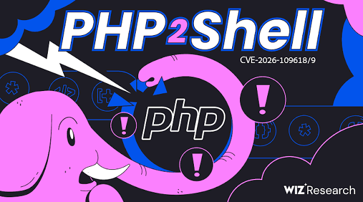

## TL;DR

PHP2Shell is a pair of critical unauthenticated remote code execution flaws in the PHP engine itself (CVE-2026-109618 and CVE-2026-109619), patched on 21 October 2026 and already exploited in the wild.

- **Severity:** CVSS v4.0 9.2 for both, per PHP.
- **Fixed in:** PHP 8.5.12, 8.4.27, 8.3.36 and 8.2.35.
- **Affected:** versions back to PHP 5.4, on every SAPI that serves web requests: PHP-FPM, Apache mod\_php, php-cgi, FrankenPHP and LiteSpeed. mod\_php is the riskiest.
- **Exploitation:** Cloudflare reported early attacks at 07:43 UTC on 21 October, over six hours before the 14:00 UTC release. watchTowr, Patchstack and Aikido also report attempts.
- **Detection:** no confirmed IOCs exist. Detection is behavioural: crashing workers, memory-limit fatals, odd multipart POSTs, and web-user processes doing things a web server should not.
- **Patching:** a patched file on disk is not enough. Restart every PHP worker.




## Timeline

The bugs sat quietly for about 10 weeks of coordinated disclosure, then a leak on 20 October compressed the defender window to hours.

| Date (UTC) | Event |
| --- | --- |
| 2026-08-01 | Calif finds multiple RCE paths ([Sansec](https://sansec.io/research/php2shell)) |
| 2026-08-11 | Calif reports the first bug to PHP and coordinated disclosure begins |
| 2026-08-24 | Wiz Research reports the vulnerabilities to PHP |
| 2026-10-20 | Details leak ahead of disclosure; watchTowr reproduces RCE; CERT-EU advisory 2026-018 lists both CVE IDs at 9.2 ([SecurityWeek](https://www.securityweek.com/php2shell-mass-exploitation-looms-for-leaked-critical-php-flaws/)) |
| 2026-10-21 03:02 | Cloudflare emergency WAF rules go live, about nine hours before disclosure |
| 2026-10-21 07:43 | Cloudflare reports early attacks |
| 2026-10-21 09:18 | Aikido reports exploitation in the wild, citing Cloudflare |
| 2026-10-21 14:00 | PHP releases fixed versions; Calif, Wiz, OpenAI and PHP disclose |
| 2026-10-21 17:50 | AlmaLinux patched packages reach testing for every PHP stream on 8, 9 and 10 ([AlmaLinux](https://almalinux.org/blog/2026-10-21-php2shell-cve-2026-109618-cve-2026-109619/)) |

## The two bugs

Both flaws come from PHP leaving internal state half-built after a fatal-error "bailout" (for example, hitting memory\_limit) and then trusting it later. Both are classed CWE-824, access of an uninitialized pointer ([Imperva](https://www.imperva.com/blog/php2shell-vulnerability-updates/)).

| CVE | PHP's title | Bug class (per Wiz and Sansec) | Impact |
| --- | --- | --- | --- |
| CVE-2026-109618 | RCE via OOM corruption | Upload-progress unserializer use-after-free | Remote memory disclosure and RCE |
| CVE-2026-109619 | RCE via stale global state | Fatal-error backtrace use-after-free; OPcache type confusion | RCE, confirmed by PHP against PHP-FPM |

**Why upload progress matters.** `session.upload_progress.enabled` is on by default and has existed since PHP 5.4. Its handler runs while a multipart body is parsed, before any application code. That is why Wiz could exploit a "Hello World" app and why app logs may show nothing. Three of the five demonstrated exploitation techniques use it as the remote trigger.

**OPcache.** OPcache stores compiled structures in shared memory and indexes them into per-worker pointer maps. Wiz found a mismatch that causes cross-worker type confusion and built an unauthenticated WordPress RCE chain from it. Turning off upload progress does not touch this path.

**Memory disclosure.** CVE-2026-109618 can return freed worker memory to the client inside a PHPSESSID cookie. That memory can hold passwords, session tokens, API keys and TLS private keys from other requests. Sansec compares it to Heartbleed. This path steals secrets without running code, so "no web shell found" does not mean "not compromised".

**Why it took until now.** Wiz says the flaws had been in PHP for decades, but exploiting them took a chain of steps at the edge of what human researchers could manage. Frontier AI models lowered that barrier ([Help Net Security](https://www.helpnetsecurity.com/2026/10/21/php2shell-php-vulnerabilities-patched-cve-2026-109618-cve-2026-109619/)). That is a story angle in itself.

**Exploit tooling.** Sansec credits an exploit tool named PHP2Shell to Calif that chains both bugs into one login-free attack. Independent PoC repositories and write-ups are also public.

## Who is exposed

Any internet-facing host running PHP 5.4 or later that serves web requests is in scope, whatever application sits on top. The flaw is in the engine, so clean application code does not help.

| PHP branch | Fixed version | Support note |
| --- | --- | --- |
| 8.5 | 8.5.12 | Fixed 21 Oct 2026 |
| 8.4 | 8.4.27 | Active support until 31 Dec 2026 |
| 8.3 | 8.3.36 | Fixed 21 Oct 2026 |
| 8.2 | 8.2.35 | Security fixes until 31 Dec 2026 |
| 8.1 and older | No official fix | Needs a vendor backport or an upgrade |

Support dates are from [Brandefense](https://brandefense.io/blog/php2shell-php-rce-cve-2026-109618-109619/) and [Sansec](https://sansec.io/research/php2shell).

**Scale.** CybelAngel's scan write-up counts 2.24 million internet-facing PHP hosts and says 59% run versions with no fix coming ([CybelAngel](https://cybelangel.com/blog/critical-php-rce-vulnerabilities-cve-2026-109618-and-cve-2026-109619/)). Treat that as one vendor's estimate.

**Applications shown exploitable without login (Calif, via Sansec):** Magento 2.4.9, WordPress 7.1.2, Drupal 11.4.3, Joomla 6.1.4, MediaWiki 1.46.2, Roundcube 1.7.4, phpMyAdmin 5.2.3, Nextcloud 35.0.1, Laravel 13.11, Symfony 8.1 and WHMCS.

**SAPI differences.** mod\_php carries the most risk. PHP confirmed RCE against PHP-FPM through CVE-2026-109619. For CVE-2026-109618, PHP says PHP-FPM is susceptible but no complete exploit has been shown ([AlmaLinux](https://almalinux.org/blog/2026-10-21-php2shell-cve-2026-109618-cve-2026-109619/)).

**Packaging traps.**

- Remi's repository (common on RHEL-based servers) did not publish fixes on 21 October. Use distribution packages or build from source.
- AlmaLinux patched packages reached testing for every stream on 8, 9 and 10, including retired ones. On mod\_php, restart Apache rather than PHP-FPM.
- Shared hosting and control panels: ask the provider to confirm the fix and the restart.

**Operational impact.** Several Dutch sites went offline as a precaution (Tweakers, the House of Representatives, the NCSC and Security.NL), and Wikimedia disabled its Phabricator hours before the patch ([Wikipedia](https://en.wikipedia.org/wiki/PHP2Shell)).

## Detection logic

No single rule catches every variant, and the vulnerable code runs below the application, so app logs may stay silent. Detect in layers and correlate. Absence of signals is not proof of safety, because the memory-disclosure path can leak secrets without running code ([php2shell.uk](https://php2shell.uk/detection)).

| Layer | Signal | Where it shows | Note |
| --- | --- | --- | --- |
| Request | Multipart POST, PUT or PATCH containing `PHP_SESSION_UPLOAD_PROGRESS` (or the configured `session.upload_progress.name`) | WAF, reverse proxy with body inspection | The most specific trigger. Default access logs do not show it. |
| Request | Deeply nested `[]` field names, many parts or fields, stalled or very large bodies, chunked requests with no content-length, aimed at any `.php` path | WAF, proxy | Armis lists these as exploit-shaped. Expect false positives on odd clients. |
| Request | A session ID supplied in a multipart form field | ModSecurity, WAF | Abstract Security's rule flags this as session fixation. Run log-only first. |
| Request | Multipart POST to endpoints that never handle uploads | Access logs, WAF | Hunting signal, not an alert. Legitimate forms can be multipart. |
| Response | `PHPSESSID` in `Set-Cookie` that is long (64+ characters) or contains `%xx` | Proxy or CDN logs of Set-Cookie | A normal ID is 32 alphanumeric characters by default. Points to the memory-leak path. |
| PHP and web logs | `Allowed memory size of` fatals right after multipart POSTs | PHP-FPM, Apache, nginx error logs | One trigger. CVE-2026-109619 has non-OOM paths, so no OOM errors does not clear you. |
| PHP and web logs | Fatals containing `in Unknown on line 0`; session warnings such as illegal session IDs | PHP error log | Early-stage failures before the script runs. |
| PHP and web logs | Bursts of HTTP 500 from one client | Access log | Exploits need several tries to fit the target's memory layout. |
| Process | Workers exiting on signal 6 or 11, segfaults, unusual worker churn | PHP-FPM log, Apache error log, dmesg, journal | Failed use-after-free attempts tend to crash the worker. |
| Host | New `.php` files under the web root; children of the web user such as `sh`, `bash`, `curl`, `wget` or `nc` | File integrity, EDR, process accounting, auditd | Classic post-exploitation. |
| Host | Established outbound connections owned by php, apache or httpd | `ss`, EDR, flow logs | Review every remote address. |

**Correlation logic (suggested).** The strongest pattern is a chain from one client: a multipart POST, then a 500 or memory fatal, then a worker crash, then within minutes a new child process or file under the web user. Alert on the chain, hunt on the single signals.

**Tuning caveat.** After patching, the new hard memory limit can also end workers abruptly. A worker exit alone is not an attack. Look for clusters tied to one client or request pattern.

## Hunting commands

Starting points adapted from [php2shell.uk](https://php2shell.uk/detection) and [Brandefense](https://brandefense.io/blog/php2shell-php-rce-cve-2026-109618-109619/). Paths are Debian and Ubuntu defaults, so adjust them for your system. Cover early October 2026 at least; Armis advises going back further.

**1. Check version and exposure**

```bash
php -v
php-fpm -v
php -i | grep -i session.upload_progress
```

The CLI reads its own `php.ini`, so confirm the setting from a request served by PHP-FPM or Apache too.

**2. Memory fatals and killed workers**

```bash
sudo grep -rh "Allowed memory size of" /var/log/php*-fpm.log /var/log/apache2/ /var/log/httpd/ /var/log/nginx/ 2>/dev/null | tail -50

sudo grep -rhE "exited on signal (6|11)|Segmentation fault|Aborted" /var/log/php*-fpm.log /var/log/apache2/ /var/log/httpd/ 2>/dev/null | tail -50
sudo journalctl --since "2026-10-01" | grep -E "php.*segfault" | tail
```

**3. Clients producing many 500s on POST (combined log format)**

```bash
sudo awk '$6=="\"POST" && $9==500 {print $1}' /var/log/nginx/access.log* /var/log/apache2/access.log* 2>/dev/null | sort | uniq -c | sort -rn | head -20
```

**4. Catch the memory leak at the proxy (nginx)**

Default logs do not record response cookies, so add a temporary format. It writes session IDs to disk, so restrict the file and remove it afterwards.

```nginx
# http {} block
log_format php2shell '$remote_addr [$time_local] "$request" $status "$sent_http_set_cookie"';
# server {} block
access_log /var/log/nginx/php2shell.log php2shell;
```

```bash
grep -E 'PHPSESSID=[^;"]{64,}|PHPSESSID=[^;"]*%' /var/log/nginx/php2shell.log
```

**5. Post-exploitation**

```bash
# PHP files changed in the web root since the bugs existed in the wild
sudo find /var/www -type f -name '*.php' -newermt '2026-08-01' -printf '%TY-%Tm-%Td %TH:%TM  %p\n' | sort | tail -100

# Anything the web user runs besides the web server itself
ps -u www-data -o pid,ppid,lstart,cmd | grep -vE 'php-fpm|apache2|httpd'

# Established connections owned by PHP or Apache
sudo ss -tpn state established | grep -E 'php|apache|httpd'
```

Also look for new cron jobs, scheduled tasks and new accounts (Huntress, via Brandefense).

The `-newermt` date is wide on purpose. Narrow it once you know your own deploy history.

## If you find something

Treat any hit as a possible secrets breach, not only a possible web shell, because the leak path needs no code execution.

1. **Preserve evidence first.** Copy web, PHP and proxy logs. Take a disk or memory snapshot if you can before rebuilding.
2. **Capture volatile state before the restart (suggested).** Patching needs a worker restart, which wipes in-memory evidence. For a suspected host, record the process tree, open connections and worker memory first.
3. **Patch or isolate.** Prefer rebuilding from a clean image over cleaning in place.
4. **Hunt persistence.** Web shells, new web-root files, cron jobs, scheduled tasks and new accounts.
5. **Rotate everything PHP could see in memory:** database passwords, API keys, OAuth client secrets, SMTP credentials, app keys (`APP_KEY`, WordPress salts) and TLS private keys if PHP could read them.
6. **Invalidate sessions** so stolen cookies stop working, and make admins sign in again.
7. **Check the blast radius:** what else those credentials reach, such as cloud accounts, internal APIs and other databases.

Steps 1, 3 and 5 to 7 follow [php2shell.uk](https://php2shell.uk/detection); step 4 follows Huntress via [Brandefense](https://brandefense.io/blog/php2shell-php-rce-cve-2026-109618-109619/).

## Patch and temporary mitigations

Update first, then restart every worker. Everything below the update is a stopgap with known gaps. PHP says only the update is a complete fix.

**Update.** Move to 8.5.12, 8.4.27, 8.3.36 or 8.2.35. Internet-facing hosts go first. On 8.1 or older, get a vendor backport or upgrade.

| Mitigation | Covers | Gap or cost |
| --- | --- | --- |
| `session.upload_progress.enabled=0`, then restart all workers | The confirmed session path of CVE-2026-109619; removes the trigger for three of five demonstrated techniques | Does nothing for CVE-2026-109618. Set it in php.ini, an FPM pool or server config, not `ini_set()` or `.user.ini`. |
| `fatal_error_backtraces=0` on PHP 8.5 | The 8.5 backtrace path | Partial |
| `memory_limit=-1` set so apps cannot override it (`php_admin_value`) | Memory-exhaustion trigger of CVE-2026-109618 | One request can consume all server memory. Pair with a container or cgroup limit that kills only the affected worker. |
| Low `post_max_size` (8M, or 32M if uploads are needed) | Shrinks the 109618 attack surface | Breaks large uploads |
| Block `multipart/form-data` at the web server or WAF | Every known trigger is multipart | Breaks file uploads and any multipart form. Test checkout flows. |
| Take PHP offline, or allow only GET and HEAD | Stops request parsing | Business downtime. CMS maintenance modes do not help because PHP parses the request first. |
| `opcache.enable=0` | The OPcache path | Performance hit |

Mitigations are from [Sansec](https://sansec.io/research/php2shell), [BleepingComputer](https://www.bleepingcomputer.com/news/security/php-ships-emergency-patches-for-critical-php2shell-flaws/), [The Hacker News](https://thehackernews.com/2026/10/php-issues-emergency-patches-for-two.html) and [Imperva](https://www.imperva.com/blog/php2shell-vulnerability-updates/).

**Edge protection.** Cloudflare published WAF rules and extended them to every plan, including Free. Sansec notes its own Shield product cannot protect these paths because they run inside PHP before application code. An edge WAF sits in front of PHP and helps, but it is a layer, not a fix.

**Do not run random PoC scripts on production.** Treat public exploit and scanner repositories as untrusted.

## Sources

- [Sansec: PHP2Shell critical PHP RCE](https://sansec.io/research/php2shell)
- [php2shell.uk: Was I hit? (detection guide)](https://php2shell.uk/detection)

**Vendor detection write-ups to check:** Akamai, Corelight, CrowdStrike, Unit 42, Cisco Talos, Cloudflare (listed on php2shell.uk).
