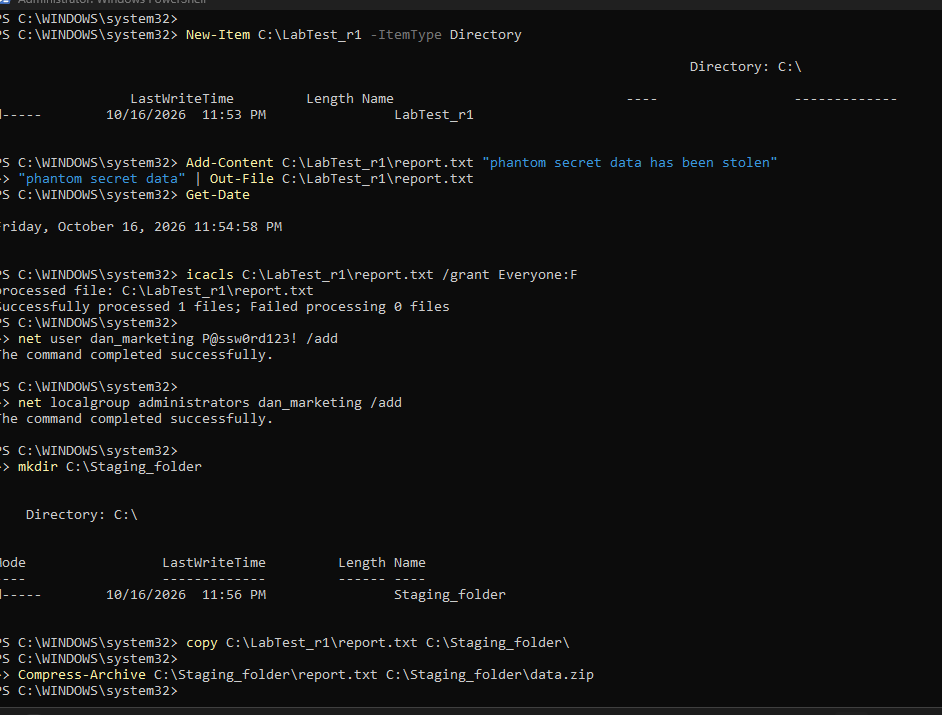

**Windows (Sysmon) and Linux (Auditd) across two simulated insider scenarios**

SOC Analyst Bootcamp · Week 2 · Visibility Assessment and Telemetry Evaluation

**Tools and skills:** Wazuh SIEM · Sysmon · Auditd · custom detection rules · Tailscale · AWS · timeline reconstruction · gap analysis

---

## 1. Executive Summary

A cloud-hosted Wazuh SIEM monitored a Windows 11 workstation and an Ubuntu virtual machine through two simulated insider scenarios: file creation with permission changes, and an admin account that creates a second account and stages data. Each endpoint was tested twice with identical actions, first with default logging, then with Sysmon (Windows) or Auditd (Linux).

> **Verdict: PARTIALLY.** The sequence of actions is well supported once log enrichment is on. Whether the data left the machine, and whether the activity was authorized, cannot be determined.

**Key findings**

1. **Default logging is blind to file activity.** It recorded logins, sudo use and account creation, but no file creation, edit or permission change.
2. **Enrichment closes most of the gap.** Auditd and Sysmon exposed commands, files and users, and Auditd's login ID (`auid`) followed actions through `sudo`.
3. **Collected is not alerted.** Both tools' events reached Wazuh but matched level-0 rules, so they stayed invisible until eight custom rules were written.
4. **The key question stays open.** No source recorded network activity or any use of the new account.

**Recommended actions:** deploy tuned Auditd and Sysmon, test every source from record to alert, and add network telemetry.

---

## 2. Incident Scope and Questions

**Scenarios.** Scenario 1 (file creation and modification): create a file, edit it, loosen its permissions. Scenario 2 (simulated insider activity): an admin account creates a second account with elevated rights, then copies, compresses and deletes the file. The two are read as one narrative: a compromised admin account staging data.

|System|Role|Telemetry compared|
|---|---|---|
|Wazuh server (AWS, Ubuntu 26.04)|Collects and analyzes events|n/a|
|Windows 11 Pro workstation, agent `oxseeker-win` (ID 001)|Windows endpoint|Default logs vs Sysmon|
|Ubuntu 26.04.1 VM, agent `Evilcorp` (ID 003)|Linux endpoint|Default logs vs Auditd|

**Investigation questions:** (1) Are the scenarios related? (2) What happened first? (3) What is proven and what is inferred? (4) What telemetry is missing? (5) Can management receive a confident answer?

**Assumptions and exclusions**

- The lab is isolated, and all test data is fictional.
- No network transfer was simulated, so exfiltration can be neither proven nor ruled out.
- Wazuh vulnerability detection was disabled to save disk space. It is irrelevant to these scenarios.
- File Integrity Monitoring was not deployed.

---

## 3. Lab Architecture

>  

**Design.** Events travel: endpoint log → Wazuh agent → manager (port 1514, over Tailscale) → rule match → alert → Filebeat → indexer → dashboard (port 443).

**Why hybrid.** The laptop used has 8 GB of RAM, and Host's Windows already used about 6 GB with only a browser open, so it could not also host the server. A free-tier cloud instance with 8 GB removed that limit at no cost. Tailscale joins machines on different networks without opening Wazuh ports to the internet, and it keeps fixed addresses even though the cloud server's public IP changes on every restart.

| Component            | Runs on                         | Role                                         |
| -------------------- | ------------------------------- | -------------------------------------------- |
| Manager              | AWS (2 vCPU, 8 GiB, Wazuh 4.14) | Decodes events, matches rules, raises alerts |
| Filebeat and indexer | AWS                             | Ship and store alerts for searching          |
| Dashboard            | AWS                             | Search interface                             |
| Agents               | Windows host and Linux VM       | Read local logs and forward them             |

**Enrichment configuration**

- **Sysmon** (schema 4.90): process creation with command line, file creation and file deletion, read through the `Microsoft-Windows-Sysmon/Operational` channel: SwiftOnSecurity config
- **Auditd:** rules for command execution, file create, rename and delete, permission changes, identity files (`/etc/passwd`, `/etc/group`, `/etc/shadow`) and sudoers, each tagged with a key (`evilcorp_exec`, `evilcorp_files`, `evilcorp_perms`, `evilcorp_identity`, `evilcorp_priv`).
- **Custom Wazuh rules:** eight rules (Appendix A) turn these records into alerts.

**Time synchronization.** All machines run in WAT (UTC+1) with automatic time sync. Three time bases exist in the evidence: alert timestamps (WAT), log lines inside alerts (UTC, one hour earlier), and the daily alert index, which rolls over at 01:00 WAT. 

---

## 4. Methodology

**Controlled comparison.** The same ten actions ran on each endpoint twice. Baselines were captured before any enrichment tool was installed, so telemetry was the only variable.

| Run | Host     | Telemetry             | When (WAT, 16 Oct)                                 |
| --- | -------- | --------------------- | -------------------------------------------------- |
| L1  | Linux VM | Default logs          | 08:42 to 09:05                                     |
| L2  | Linux VM | Auditd + custom rules | About 22:30 to 23:28                               |
| W1  | Windows  | Default logs          | 23:53 to 23:59                                     |
| W2  | Windows  | Sysmon + custom rules | 2026-10-17 00:53:56.766 to 2026-10-17 01:41:17.820 |

|Step|Action|Linux|Windows|
|---|---|---|---|
|1|Create folder|`mkdir`|`New-Item`|
|2|Create file|`echo > report.txt`|`Out-File`|
|3|Modify file|`echo >> report.txt`|`Add-Content`|
|4|Loosen permissions|`chmod 777`|`icacls /grant Everyone:F`|
|5|Create account|`sudo useradd`|`net user /add`|
|6|Add to admin group|`sudo usermod -aG sudo`|`net localgroup administrators /add`|
|7|Staging folder|`mkdir`|`mkdir`|
|8|Copy file|`cp`|`copy`|
|9|Compress|`tar -czf`|`Compress-Archive`|
|10|Delete original|`rm`|`Remove-Item`|

Steps 1 to 4 are Scenario 1, and steps 5 to 10 are Scenario 2.

**Evidence collection.** Each command was  followed by a `date` reading to bracket its time. About two minutes later, the dashboard was searched by agent and time window. Each alert was opened to read user, command, path and `auid`. Empty searches were kept as evidence. Test accounts were `dan_marketing` (L1, W1) and `dan_finance` (L2), with new folder names per run.

>  _

---

## 5. Timeline Reconstruction

Times are Wazuh alert timestamps in WAT, 16 October.

| Time                 | Host         | User        | Activity                               | Evidence source                      | Figure |
| -------------------- | ------------ | ----------- | -------------------------------------- | ------------------------------------ | ------ |
| 08:41:31             | Evilcorp     | oxseeker    | Wrong sudo password                    | Linux default (pam_unix failure)     | 3      |
| 08:42 to 08:49       | Evilcorp     | oxseeker    | Folder and file created, appended (L1) | None                                 | 4      |
| 08:53 to 08:58       | Evilcorp     | oxseeker    | `chmod 777` (L1)                       | None                                 | 4      |
| 08:58:37             | Evilcorp     | oxseeker    | `useradd dan_marketing`                | Linux default (rules 5902, 5901)     | 3      |
| 08:59:27             | Evilcorp     | oxseeker    | `usermod -aG sudo`                     | Linux default (sudo line, rule 5402) | 5      |
| 22:42:17             | Evilcorp     | oxseeker    | `usermod -aG sudo dan_finance`         | Auditd (rule 100100)                 | 7      |
| 23:00 to 23:01       | Evilcorp     | dan_finance | Two failed SSH logins                  | Security event logs                  | n/a    |
| 23:26:15             | Evilcorp     | oxseeker    | `mkdir` staging folder                 | Auditd (100102, 100103)              | 7      |
| 23:27:14             | Evilcorp     | oxseeker    | `cp` report to staging                 | Auditd (100102, 100103)              | 7      |
| 23:28:11             | Evilcorp     | oxseeker    | `tar`, `gzip` build archive            | Auditd (100102)                      | 7      |
| 23:28:26             | Evilcorp     | oxseeker    | `rm` deletes original                  | Auditd (100102, 100103)              | 7      |
| 23:53 to 23:59       | oxseeker-win | oxseeker    | Ten actions (W1)                       | Windows default security event logs  | 8      |
| 00:53:56 to 01:41:17 | oxseeker-win | oxseeker    | Ten actions (W2)                       | Sysmon (100200, 100201, 100203)      | 9      |

**Reading the timeline.** The activity falls into three phases: preparing the file (steps 1 to 4), creating access (5 and 6), and staging and removing the data (7 to 10). Default logging saw only the middle phase. Enrichment exposed all three, in order, under one login.

---

## 6. Telemetry Analysis

### 6.1 Linux, default logging

**Observed:** sudo use (rule 5402), PAM sessions (5501, 5502), and account creation (new user 5902 and new group 5901, level 8). No alert appeared for folder or file creation, the edit or `chmod 777`. 

>
>

> 
>

**Meaning:** default Linux logging records who used sudo and who was created, not what happened to files.

>  > 

The `full_log` line reads `COMMAND=/usr/sbin/usermod -aG sudo dan_marketing`. No separate group-change alert exists, so this one line carries the whole privilege change.

### 6.2 Linux with Auditd

**Observed:** Auditd recorded every action from the start, but nothing reached the dashboard. The events carried custom keys, matched only the generic rule 80700 at level 0, and were never alerted. Custom rules 100100 to 100104, chained to rule 80700 on `audit.key`, resolved this.

> 

After the fix, rule 100102 fired for every command, 100103 for file events (`mkdir`, `cp`, `rm`), 100104 for permission and ownership changes, and 100100 when `usermod` touched the identity files, which closes the L1 gap. 

> **Show:** the alert table for 23:26 to 23:29 WAT (rules 100102 and 100103) with one alert expanded to show `audit.command` and `audit.auid`.  
> 

**Meaning:** the `auid` stays the same even when a command runs as root through sudo, so every action traces to one account. The cost is noise: one `usermod` produced many 100103 and 100104 alerts.

### 6.3 Windows, default logging

**Observed:** That Windows the windows test logged events like 4720 (user created) and 4732 (added to Administrators) and no other command from me was present asides this two
> 
> **Show:** W1 alert table for `oxseeker-win` over the run window (an empty result is valid evidence).  
> 

**Meaning**: Windows doesn't log file changes by default only account related changes are logged eg useradd and group add 

### 6.4 Windows with Sysmon

**Observed:** as with Auditd, Sysmon events matched level-0 rules until custom rules were added (100200 process creation, 100201 file creation, 100203 file deletion). Sysmon then recorded commands with arguments, file copies and deletions (events 11 and 26), and new folders as file creation. It did not record file edits (`Add-Content`). User creation and the permission change appeared only as the commands `net user` and `icacls`. Windows Security event 4720 would record account creation, but its delivery to Wazuh was not confirmed.

>  
> **Show:** alerts for rules 100200, 100201 and 100203 for `oxseeker-win` over the W2 window.  
> 

>   
> **Show:** one rule 100200 alert expanded, with the command line and parent process visible.  
>

**Meaning:** Sysmon turns "something ran" into "this command ran, with these arguments". Its blind spot is file content changes.

---

## 7. Correlation Analysis

**Are the scenarios related? Partially.** The file prepared in Scenario 1 is the one staged and deleted in Scenario 2, by the same login on the same host.

|Link|Evidence|Strength|
|---|---|---|
|Same actor|One `auid` (1000) across every Auditd record, even as root|Strong with Auditd|
|Same file|The file opened to everyone is the one copied, archived and deleted|Strong with Auditd|
|Sequence|Create, loosen, create account, grant rights, copy, compress, delete in one session|Moderate|
|New account|Identity files touched (100100) just before staging|Moderate|

**Competing explanations.** (1) Routine administration: adding a colleague and archiving a file for backup. (2) Two unrelated tasks that happened close together. The incident reading is favoured by the combination of a world-writable file, a new account with sudo rights and a deleted original. The routine reading is favoured by one normal admin login and no evidence of data leaving.

|Proven|Inferred|Unknown|
|---|---|---|
|Actions, order, actor and commands (with enrichment)|The sequence forms one incident|Intent, authorization, exfiltration, use of the new account|

**Confidence: partial.**

---

## 8. Visibility Comparison

| Activity / question               | Windows logs | Sysmon  | Linux logs | Auditd | Analyst note                                                                                                                                                             |
| --------------------------------- | ------------ | ------- | ---------- | ------ | ------------------------------------------------------------------------------------------------------------------------------------------------------------------------ |
| Who performed it?                 | Yes          | Yes     | Partial    | Yes    | Default Linux names the user only in sudo lines. Auditd attaches `auid` to everything                                                                                    |
| What command ran?                 | No           | Yes     | Partial    | Yes    | Default Linux shows commands only when run with sudo                                                                                                                     |
| Which process was involved?       | No           | Yes     | No         | Yes    | Sysmon and Auditd give process path; default Linux gives none                                                                                                            |
| What network connection occurred? | No           | No      | No         | No     | Not configured on any source                                                                                                                                             |
| What file or permission changed?  | Yes          | Partial | Partial    | Yes    | Sysmon: create and delete, not edits; `icacls` only as a command. Linux default: accounts and groups, no files or `chmod`. Auditd: files, permissions and identity files |

**Investigative value of enrichment.** Enrichment turned "an admin logged in" into "this account created, opened up, copied and deleted this file". It cost custom rules and noise: eight rules to write, a process rule that fires on every launch, and many alerts from one `usermod`.

---

## 9. Visibility Gap Analysis

|Unanswered question|Why evidence is missing|Required telemetry or configuration|Priority|
|---|---|---|---|
|Did the archive leave the machine?|No network telemetry or transfer step|Auditd `connect` rule with a Wazuh rule; Sysmon Event 3|High|
|Were files edited on Windows?|Sysmon does not log edits|File Integrity Monitoring or object-access auditing|High|
|Why did enriched events not alert?|They matched level-0 rules|One tested custom rule per source and key|High|
|Was the new account ever used?|No password set; only failed SSH attempts|Reviewed authentication alerts for new accounts|Medium|
|Who created accounts on Windows?|Only the commands were seen; event 4720 unconfirmed|Confirm 4720 delivery; account-management auditing|Medium|
|Was the pipeline healthy?|The Windows agent stopped on low disk; a full server disk blocked the indexer|Monitor disk space, agent status and Filebeat errors|Medium|

---

## 10. Findings and Lessons Learned

**Findings**

1. Default logging covers identity (who logged in, who used sudo, who was created) but not activity on files.
2. Auditd and Sysmon add command, process, user and file evidence, with different blind spots: Sysmon misses file edits, and neither source covers the network by default.
3. Enrichment without detection rules produces no alerts. Two tools needed eight custom rules.
4. Evidence from different sources runs on different clocks, so each source's time base has to be recorded.

**Assumptions that did not survive testing**

|Expected|Observed|
|---|---|
|An Active agent means events appear in the dashboard|The agent was Active while the indexer could not create the day's index|
|Enriched logs arrive as alerts|They matched level-0 rules and stayed silent|
|`usermod -aG` raises a group-change alert|Only a sudo line appeared by default|

**Lesson.** Test the whole path, from the record to the dashboard alert, whenever a log source is added.

---

## 11. Recommendations

|Priority|Recommendation|Why|Effort|
|---|---|---|---|
|Immediate|Deploy tuned Auditd and Sysmon|They expose commands, files and users that default logging misses|Low|
|Immediate|Write and test a rule for every custom source, key or event type|Without one, enriched data never alerts|Low|
|Immediate|Alert on new accounts and on sudo or Administrators group changes|These are cheap, high-signal persistence indicators|Low|
|Longer term|Add network telemetry (Auditd `connect`, Sysmon Event 3)|Answers the exfiltration question|Medium|
|Longer term|Add File Integrity Monitoring on sensitive folders|Covers the file edits Sysmon misses|Medium|
|Longer term|Tune noisy rules and monitor SIEM health (disk, agents, Filebeat)|Keeps alerts readable and the pipeline trustworthy|Medium|

---

## 12. Conclusion and Management Brief

> **Final answer: PARTIALLY.**

**What happened.** One admin login created a file, opened its permissions to everyone, created a second account with elevated rights, then copied, compressed and deleted the file. With Auditd and Sysmon, the sequence can be shown in order, with the user and commands.

**Confidence.** The actions and their order are well supported once enrichment is on. Reading them as one incident is a reasonable inference, not proof.

**What remains uncertain.** Whether the activity was authorized, whether the new account was used, and whether the archive left the machine.

**Message for management.** Default logging could not have reconstructed this incident. Enriched telemetry can, but only after detection rules are written and tested. Invest in enrichment, test it from record to alert, and add network visibility.

## Appendix A. Custom Wazuh rules

|Rule|Level|Parent|Detects|
|---|---|---|---|
|100100|5|80700|Identity files (`evilcorp_identity`)|
|100101|8|80700|Sudoers (`evilcorp_priv`)|
|100102|3|80700|Command execution (`evilcorp_exec`)|
|100103|3|80700|File create, rename, delete (`evilcorp_files`)|
|100104|5|80700|Permission and ownership changes (`evilcorp_perms`)|
|100200|3|61603|Sysmon process creation|
|100201|5|61613|Sysmon file creation|
|100203|5|61654|Sysmon file deletion **[CONFIRM: delete test]**|
